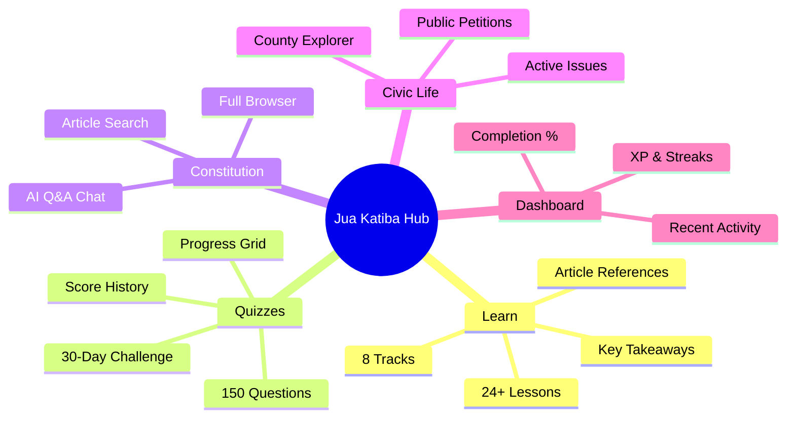
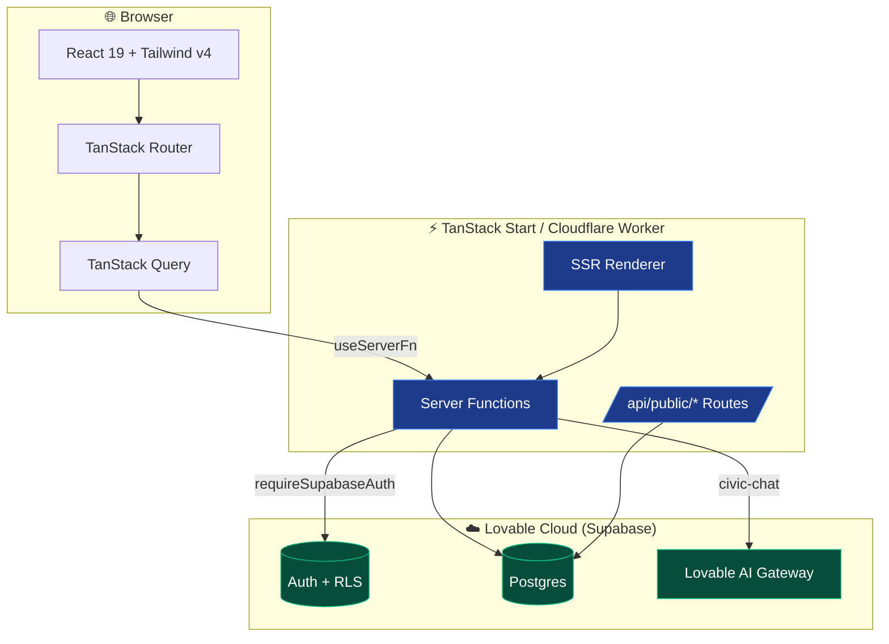
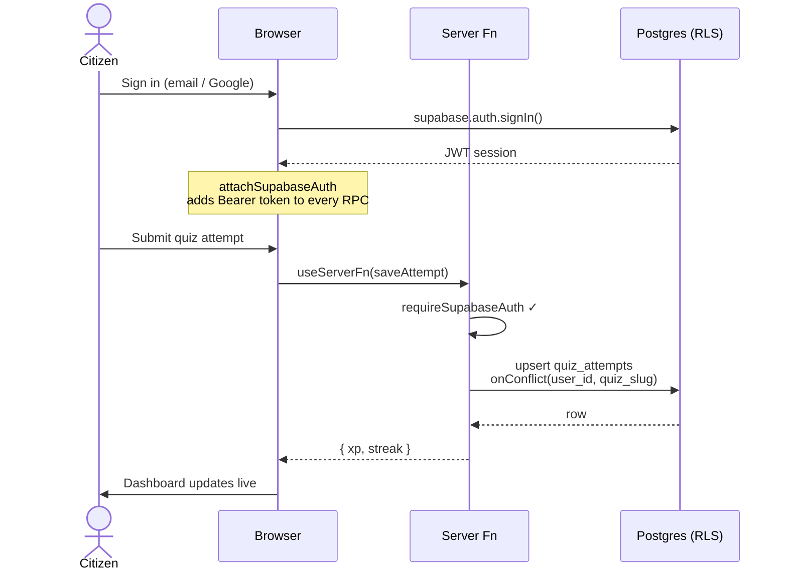
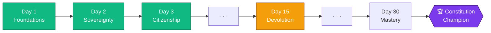
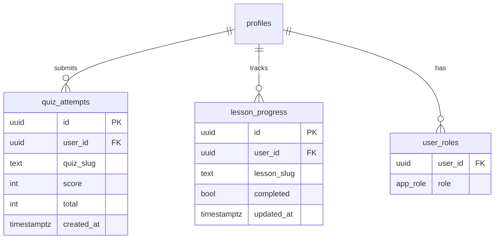

# Jua Katiba Hub

> **Know your Constitution. Own your citizenship.**
> An interactive civic education platform for Kenyans — built around the 2010 Constitution, devolution, rights, and accountability.

 create badge - https://juakatibaai.vercel.app/ 

---

## ✨ Why this exists

Most Kenyans have never read the Constitution they live under. Jua Katiba Hub turns the document into something you can **learn, quiz, and live** — eight guided tracks, a 30-day daily challenge, county explorers, and a civic AI chat that explains rights in plain language.

```
"Citizens who know their rights are harder to govern badly."
```

---

## 🧭 Feature Map



---

## 🏗️ Architecture



---

## 🧱 Tech Stack

| Layer            | Choice                                     |
| ---------------- | ------------------------------------------ |
| Framework        | **TanStack Start v1** (React 19, Vite 7)   |
| Routing          | File-based, type-safe (`src/routes/`)      |
| Styling          | Tailwind CSS v4 + semantic tokens (oklch)  |
| UI Primitives    | shadcn/ui + Radix                          |
| Animation        | Framer Motion                              |
| Data Layer       | TanStack Query + `createServerFn`          |
| Backend          | Lovable Cloud (Supabase Postgres + Auth)   |
| AI               | Lovable AI Gateway (Gemini 2.5 Flash)      |
| Deploy           | Cloudflare Workers (edge) / Vercel-ready   |

---

## 🗂️ Project Structure

```
src/
├── routes/                         # File-based routing
│   ├── __root.tsx                  # HTML shell
│   ├── index.tsx                   # Landing page
│   ├── _authenticated.tsx          # Auth-gated layout
│   ├── _authenticated/
│   │   └── dashboard.tsx           # User dashboard
│   ├── learn.tsx                   # /learn layout (Outlet)
│   ├── learn.index.tsx             # Track listing
│   ├── learn.$trackSlug.tsx        # Lesson detail
│   ├── quizzes.tsx                 # /quizzes layout
│   ├── quizzes.index.tsx           # 30-day grid
│   ├── quizzes.day.$day.tsx        # Daily quiz
│   ├── constitution.tsx            # AI-powered browser
│   ├── counties.tsx · issues.tsx · about.tsx · auth.tsx
├── data/
│   ├── learn-content.ts            # 8 tracks · 24+ lessons
│   └── daily-quizzes.ts            # 30 days · 150 questions
├── integrations/supabase/          # Auto-generated clients
└── components/ui/                  # shadcn primitives
```

---

## 🔐 Auth & Data Flow



---

## 🎓 The 30-Day Civic Challenge



Each day = **5 questions** drawn from a themed Constitution chapter. Scores upsert under slug `daily-day-N` so retries update instead of duplicating.

---

## 🗃️ Database (high level)



All tables are **RLS-protected**; every policy scopes to `auth.uid()`. Roles live in a separate `user_roles` table behind a `SECURITY DEFINER` `has_role()` function to prevent privilege escalation.

---

## 🚀 Getting Started

```bash
bun install
bun dev          # http://localhost:8080
bun run build    # production bundle (Cloudflare Worker)
```

Environment is auto-wired by Lovable Cloud — no `.env` editing required.

---

## 🧪 Quality Checks

- **Idempotent writes** — quiz + lesson saves use `upsert(..., { onConflict })`
- **Type-safe routes** — every `<Link to="...">` is checked at build time
- **Layout outlets** — parent routes (`learn.tsx`, `quizzes.tsx`) render `<Outlet />` so nested pages mount
- **Auth-protected loaders** live only under `_authenticated/` to avoid SSR 401s

---

## 🛣️ Roadmap

- [ ] Interactive county map (Mapbox / SVG choropleth)
- [ ] Civic news feed (verified sources)
- [ ] Public petitions with signature thresholds
- [ ] Swahili content track
- [ ] Printable "Citizen's Card" certificate after Day 30

---

## 📜 License

Built with ❤️ for the people of Kenya. Educational use encouraged.
