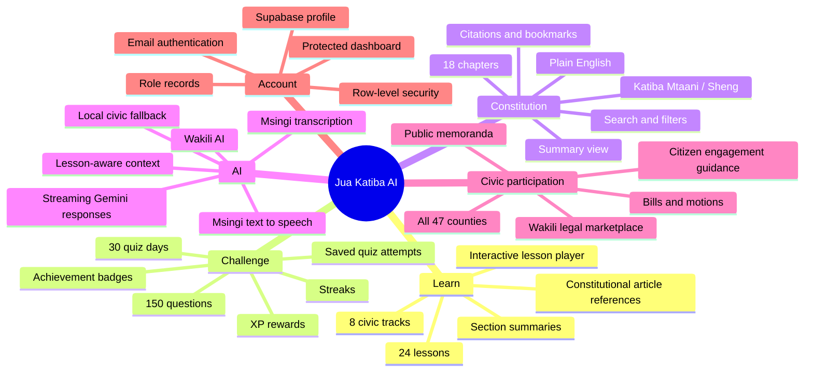
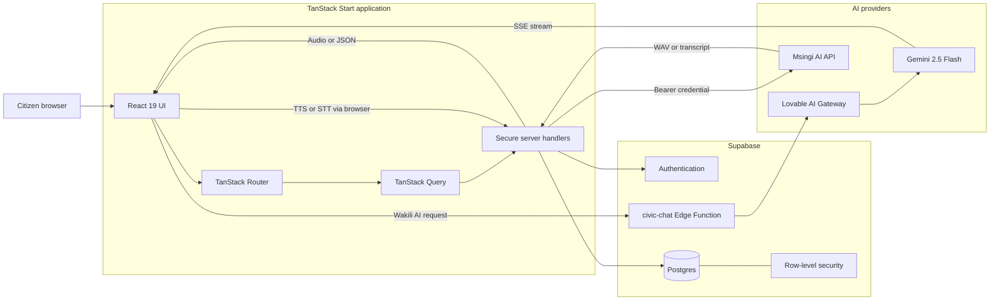
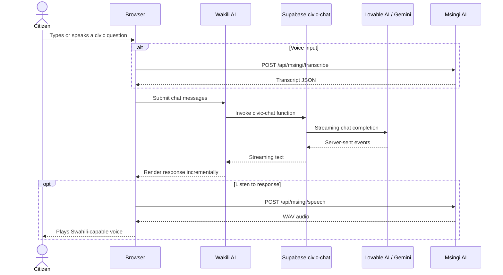
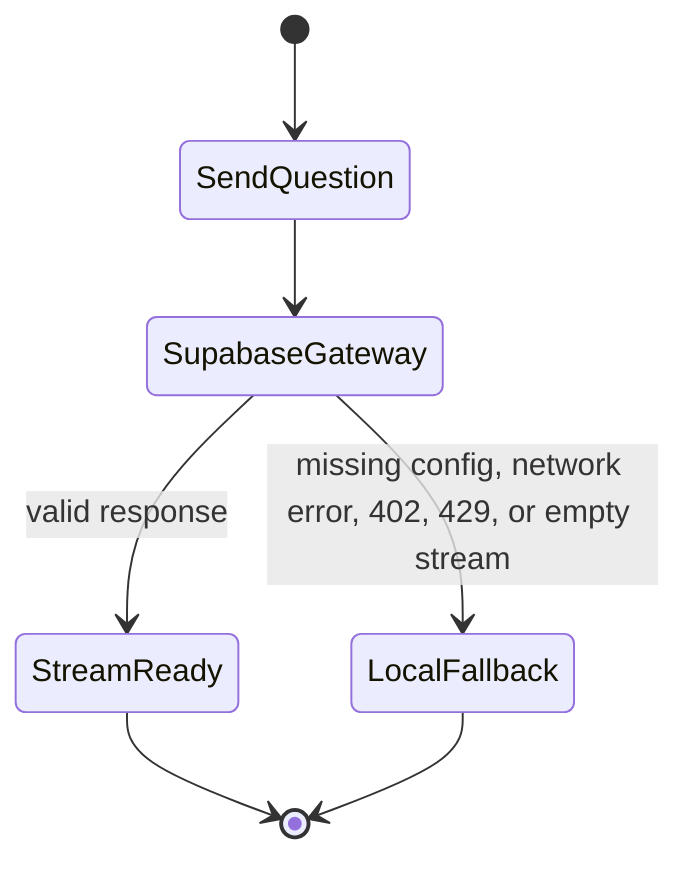
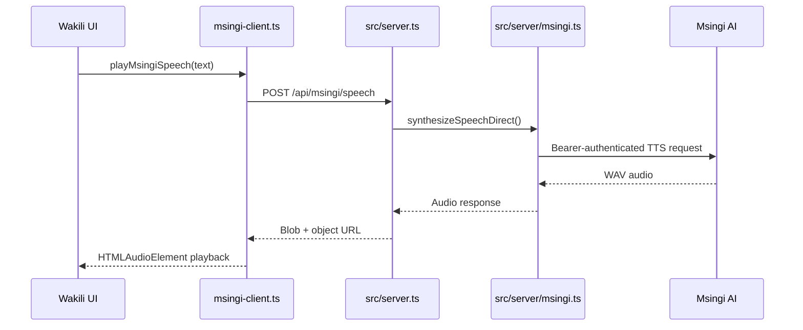
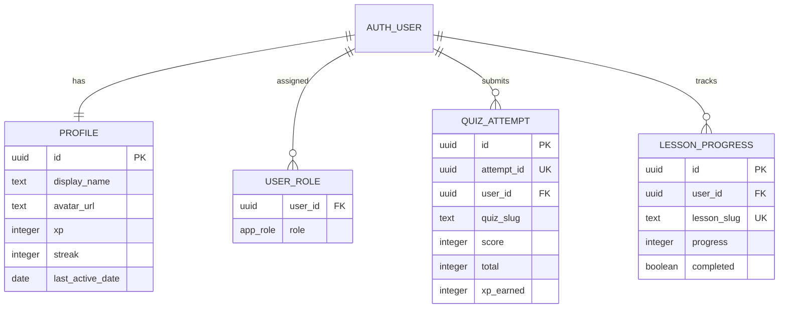

# Jua Katiba AI🇰🇪

<div align="center">

**Know your Constitution. Understand your rights. Take civic action.**

[Live application](https://juakatibaai.vercel.app) · [Constitution Explorer](https://juakatibaai.vercel.app/constitution) · [Wakili AI](https://juakatibaai.vercel.app/dashboard)

[](https://juakatibaai.vercel.app)
[](https://react.dev/)
[](https://tanstack.com/start)
[](https://supabase.com/)

</div>

Jua Katiba AI is a mobile-first civic education platform for Kenya. It turns the Constitution of Kenya 2010 into structured lessons, interactive quizzes, searchable constitutional chapters, practical citizen guidance, and two integrated AI experiences:

- **Wakili AI** for conversational constitutional and civic guidance.
- **Msingi AI** for Swahili-aware speech transcription (STT) and text-to-speech (TTS).

The platform is designed for plain-language learning across English, Kiswahili, and Kenyan Sheng. It is educational, not legal advice.

---

## Platform at a glance

| Experience | What users can do |
| --- | --- |
| Constitution Explorer | Browse 18 chapters and key articles, search provisions, switch between plain English, Sheng, and summary views, copy citations, and save bookmarks |
| Guided Learning | Complete 8 civic-learning tracks containing 24 structured lessons, with takeaways and relevant article references |
| 30-Day Challenge | Answer 150 questions across 30 themed quiz days and track progress |
| Wakili AI | Ask constitutional questions in chat, receive article-grounded answers, and continue context-aware lesson conversations |
| Msingi Voice | Dictate questions and listen to Wakili AI responses using Msingi AI speech services |
| Civic Dashboard | View profile, XP, streak, achievements, lesson progress, quiz history, and voice-enabled AI chat |
| Counties & Devolution | Search the complete list of Kenya's 47 counties and learn about devolved government |
| Public Issues | Explore public participation, parliamentary trackers, bills, motions, memoranda, and citizen guidance |
| Wakili Hub | Discover, filter, and register interest with lawyers and post client legal requests |
| Gamification | Earn XP, maintain streaks, unlock badges, hear feedback sounds, and share achievements |

---

## Feature overview



---

## System architecture



### Request flows



If Wakili AI is unavailable, the civic service returns an immediate, local constitutional fallback rather than leaving the chat stuck.

---

## Wakili AI

Wakili AI is Jua Katiba's conversational constitutional assistant.

- Streams responses through the Supabase `civic-chat` edge function.
- Uses **Lovable AI Gateway** with **Google Gemini 2.5 Flash**.
- Adds lesson or article context to the system prompt when a user is studying.
- Supports plain English, Kiswahili phrases, and Katiba-Mtaani/Sheng explanations.
- Grounds answers in constitutional articles and explains practical next steps.
- Has an offline/local civic fallback for common topics such as arrests, police searches, peaceful assembly, court precedent, complaints, and public participation.
- Disclaims that responses are educational and directs personal legal matters to a qualified advocate.

### Fallback behavior



---

## Msingi AI voice integration

Msingi AI provides both sides of the voice conversation:

| Capability | Endpoint | Voice or format |
| --- | --- | --- |
| Text-to-speech | `POST /api/msingi/speech` | Default: `female3`, sanitized text, WAV output |
| Speech-to-text | `POST /api/msingi/transcribe` | Browser audio, transcript JSON |

The browser never receives the Msingi API key. It calls server-owned routes; `src/server/msingi.ts` forwards requests with the API key from server environment variables.



Speech text is Markdown-cleaned and truncated safely to Msingi's 2,000-character limit. Voice recording uses the browser `MediaRecorder`, then uploads the recording as multipart audio for transcription.

---

## Data and gamification model



Supabase Row-Level Security is enabled for profiles, quiz attempts, lesson progress, and roles. User-owned records are restricted to `auth.uid()`. Admin operations use a separate role table and a `SECURITY DEFINER` `has_role()` function.

XP, streaks, badges, and local gamification feedback are implemented in `src/lib/gamification.ts`. Quiz attempts include idempotency support through `attempt_id`, preventing the same attempt from being inserted twice.

---

## Technology stack

| Area | Technology |
| --- | --- |
| Framework | TanStack Start 1, React 19, Vite 7 |
| Routing | Type-safe TanStack file-based routing |
| Styling | Tailwind CSS 4, CSS variables, `shadcn/ui`, Radix primitives |
| Animation | Framer Motion |
| State and data | TanStack Query and React state |
| Authentication | Supabase Auth with Lovable Cloud integration |
| Database | Supabase Postgres |
| Voice AI | Msingi AI TTS and STT |
| Chat AI | Lovable AI Gateway and Gemini 2.5 Flash |
| Server | TanStack Start server entry on Cloudflare/Vercel-compatible runtimes |
| Deployment | Vercel; Cloudflare Workers configuration included |
| Language | TypeScript |

---

## Project structure

```text
.
├── src/
│   ├── components/
│   │   ├── chat/                   # Wakili voice and chat copilot
│   │   ├── learn/                  # Interactive lesson player
│   │   ├── site/                   # Navbar, footer, and application shell
│   │   └── ui/                     # shadcn/Radix UI primitives
│   ├── data/
│   │   ├── learn-content.ts        # 8 tracks and 24 lessons
│   │   ├── daily-quizzes.ts        # 30 days and 150 questions
│   │   ├── lesson-gamification.ts  # Lesson and badge gamification data
│   │   └── lawyers-data.ts         # Wakili Hub listing and request data
│   ├── integrations/
│   │   └── supabase/               # Browser/server Supabase clients and auth middleware
│   ├── lib/
│   │   ├── civic-ai-service.ts     # Wakili AI streaming and local fallback
│   │   ├── msingi-client.ts        # Browser Msingi STT/TTS client
│   │   └── gamification.ts         # XP, streak, and badge logic
│   ├── routes/
│   │   ├── index.tsx               # Landing page
│   │   ├── constitution.tsx        # Constitution Explorer
│   │   ├── learn.tsx               # Learning layout
│   │   ├── learn.$trackSlug.tsx    # Track and lesson view
│   │   ├── quizzes.tsx             # Challenge layout
│   │   ├── quizzes.day.$day.tsx   # Daily quiz
│   │   ├── counties.tsx            # All 47 counties
│   │   ├── issues.tsx              # Civic and legislative trackers
│   │   ├── lawyers.tsx             # Wakili legal marketplace
│   │   └── _authenticated/
│   │       └── dashboard.tsx       # Account dashboard and AI chat
│   ├── server/
│   │   └── msingi.ts               # Server-side Msingi proxy
│   └── server.ts                   # Msingi API routes and TanStack Start entry
├── supabase/
│   ├── functions/civic-chat/       # Gemini streaming edge function
│   ├── migrations/                 # Profiles, roles, progress, and attempt tables
│   └── config.toml
├── public/
├── vercel.json
└── wrangler.jsonc
```

---

## Local development

### Prerequisites

- Node.js 20 or newer
- npm
- A Supabase project
- A Lovable AI Gateway key for the `civic-chat` edge function
- A Msingi AI API key for voice features

### 1. Clone and install

```bash
git clone https://github.com/lewiii254/Jua-katiba-AI.git
cd Jua-katiba-AI
npm install
```

### 2. Configure environment variables

Copy the example file:

```bash
cp .env.example .env
```

Use server-only variables for credentials and `VITE_` variables only for values intentionally needed by browser code.

```dotenv
# Public browser configuration
VITE_SUPABASE_URL=https://your-project.supabase.co
VITE_SUPABASE_PUBLISHABLE_KEY=your_supabase_anon_or_publishable_key
VITE_SUPABASE_PROJECT_ID=your_project_ref

# Server configuration
SUPABASE_URL=https://your-project.supabase.co
SUPABASE_PUBLISHABLE_KEY=your_supabase_anon_or_publishable_key
MSINGI_API_KEY=your_msingi_api_key
MSINGI_BASE_URL=https://api.msingiai.com
```

Do not put `MSINGI_API_KEY`, Supabase service-role credentials, or `LOVABLE_API_KEY` in `VITE_` variables or source code.

The Supabase edge function requires a secret named `LOVABLE_API_KEY`. Configure it with the Supabase CLI or project dashboard rather than a browser environment file.

### 3. Apply database migrations

Run the SQL migrations in `supabase/migrations/` for your Supabase project. The migrations create profiles, roles, quiz attempts, lesson progress, RLS policies, and quiz attempt idempotency.

### 4. Deploy or serve the chat function

Deploy `supabase/functions/civic-chat/index.ts` to your Supabase project and configure `LOVABLE_API_KEY`.

### 5. Start the application

```bash
npm run dev
```

The app is available at `http://localhost:5173` unless Vite reports a different port.

---

## Scripts

| Command | Purpose |
| --- | --- |
| `npm run dev` | Start the Vite/TanStack development server |
| `npm run build` | Create the production build |
| `npm run preview` | Preview the production build |
| `npm run lint` | Run ESLint |
| `npm run format` | Format files with Prettier |
| `npm run greeting` | Run the customer greeting utility |

---

## Deployment

### Vercel

`vercel.json` uses:

```text
install: npm ci
build:   npm run build
```

Configure the environment variables in the Vercel project. Add `SUPABASE_URL`, `SUPABASE_PUBLISHABLE_KEY`, `VITE_SUPABASE_URL`, `VITE_SUPABASE_PUBLISHABLE_KEY`, `MSINGI_API_KEY`, and optionally `MSINGI_BASE_URL`.

### Cloudflare Workers

`wrangler.jsonc` identifies `src/server.ts` as the worker entry point and enables Node.js compatibility. Configure Msingi and Supabase variables in the Worker environment or secrets manager.

For either target:

1. Keep Msingi and service credentials server-only.
2. Restrict Supabase policies to the intended users.
3. Rotate credentials if they have ever been committed to Git history.
4. Configure the Supabase edge function separately.

---

## Security and privacy

- Supabase RLS protects user-owned progress and quiz data.
- The Msingi API key is read on the server and forwarded from `/api/msingi/*` routes.
- Browser audio is sent only to the application's Msingi proxy.
- Authentication middleware protects server functions and the authenticated dashboard route.
- Profile, role, quiz, and lesson tables are scoped by authenticated user ID.
- Civic AI responses are educational and must not be treated as legal advice.

Never use `MSINGI_API_KEY` or `LOVABLE_API_KEY` as browser variables. If a provider key is exposed, revoke it and issue a replacement immediately.

---

## Routes

| Route | Purpose |
| --- | --- |
| `/` | Product landing page |
| `/constitution` | Constitution Explorer |
| `/learn` | Learning track catalogue |
| `/learn/$trackSlug` | Individual track and interactive lessons |
| `/quizzes` | 30-day challenge overview |
| `/quizzes/day/$day` | Daily quiz |
| `/counties` | Search all 47 Kenyan counties |
| `/issues` | Bills, motions, public participation, and civic issues |
| `/lawyers` | Wakili Hub legal marketplace |
| `/dashboard` | Authenticated profile, progress, quiz history, and AI chat |
| `/auth` | Sign-in and account access |
| `/about` | Project mission and principles |

---

## Contributing

1. Create a focused branch.
2. Keep changes aligned with existing TanStack routes, shadcn components, and Supabase patterns.
3. Add or update focused tests for behavior changes where practical.
4. Run `npm run lint` and `npm run build` before opening a pull request.
5. Do not commit `.env`, provider keys, Supabase service-role keys, or personal data.

---

## Educational disclaimer

Jua Katiba AI provides general civic education and constitutional information for Kenya. It is not a substitute for advice from a licensed advocate, judge, public officer, or other qualified professional. Legislation and public deadlines can change; users should verify significant decisions with official Kenyan sources.

---

## License

See the repository for licensing details. Built for civic education, constitutional awareness, and informed participation in the Republic of Kenya.
